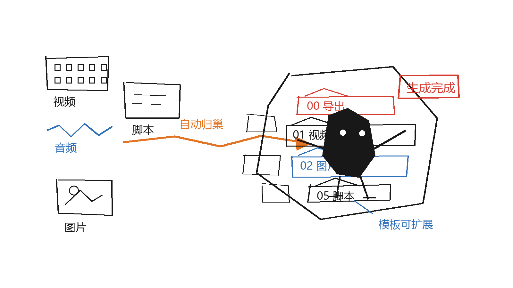

# VideoNest 视频素材巢



VideoNest 是一个 Windows 本地桌面工具，用于根据项目名称和日期自动生成统一的视频素材目录，方便管理自媒体视频项目。

当前版本：`0.1.0`

## 功能

- 输入项目名称、项目日期和保存路径
- 自动生成 `YYYY-MM-DD_项目名称` 根目录
- 自动创建视频、图片、音频、工程文件、脚本、参考资料等固定目录
- 自动创建 `项目说明.md`、`素材清单.csv`、`拍摄清单.md`
- 自动替换 Windows 文件名非法字符：`/ \ : * ? " < > |`
- 目标文件夹已存在时提示确认，继续后不会覆盖已有同名文件
- 生成成功后自动打开项目文件夹

## 目录结构

```text
00_导出
  成片
  小样
01_视频
  A-Roll_口播
  B-Roll_补充画面
  其他素材
02_图片
  封面
  包装设计素材
  图片素材
03_音频
  BGM
  音效
  录音
04_工程文件
  剪映
  Premiere
  达芬奇
05_脚本
  口播稿
  分镜
  拍摄清单
99_参考资料
```

## 本地运行

```powershell
python -m venv .venv
.\.venv\Scripts\Activate.ps1
pip install -r requirements.txt
python main.py
```

如果 PowerShell 禁止激活脚本，可以直接使用：

```powershell
.\.venv\Scripts\python.exe main.py
```

## 打包 exe

```powershell
pyinstaller --noconfirm --onefile --windowed --name VideoNest-0.1.0 --version-file version_info.txt main.py
```

打包完成后，exe 位于：

```text
dist\VideoNest-0.1.0.exe
```

## 项目结构

```text
main.py
requirements.txt
README.md
version_info.txt
videonest/
  __init__.py
  app.py
  generator.py
  templates.py
```

后续扩展模板功能时，优先修改 `videonest/templates.py`；目录生成和校验逻辑位于 `videonest/generator.py`；GUI 入口位于 `videonest/app.py`。
